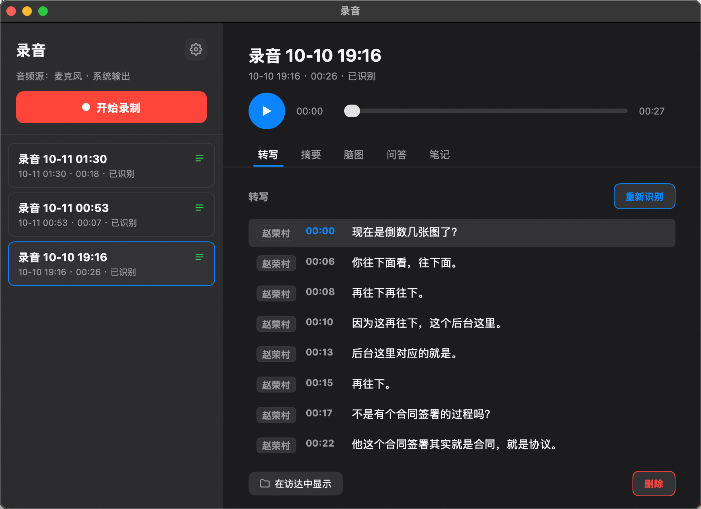

> 一次关于「把会议录音这件事收回到本地」的尝试：录制、转写、摘要、脑图、问答、笔记，一个窗口装下。



## 为什么要自己写一个

开会这件事的痛点很稳定：说了什么记不住，记了笔记又来不及听。

市面上的会议助手不少，但它们大多长一个样——注册、登录、把会议音频传到某个云端、等一个订阅制的转写额度。对于内容敏感的会议，「把录音上传到别人服务器」本身就是个需要犹豫三秒的动作；而对于只是想把每周例会的结论留个底的人来说，为这个装一个订阅制 SaaS 也未免太重。

所以我想要的东西很朴素：

- **录音和资料库在本地。** 录下来的东西是我的文件，存在我选的目录里，索引也是本地一个 JSON。
- **转写和 AI 能力按需接。** 用哪家的语音识别、用哪家的大模型，我自己填 Key，不绑定任何平台账号。
- **不配也能用。** 没有 Key 的时候，它至少是个能录音、能播放、能记笔记的录音机，而不是一个打不开的空白页。

于是有了 **有听有记 Voxi**——一个 macOS 上的会议助手。整个项目 **4800 行 Go**（含测试），直接依赖只有两个：`purego` 和 `mygo`。

## 它长什么样

一个窗口，左边录音库，右边详情。

| 页签     | 做什么                                                       |
| -------- | :----------------------------------------------------------- |
| **转写** | 带时间戳的分段文字。点时间戳跳转播放、点文字就地改（自动保存）、点说话人改名（可只改这条，也可改全部同名） |
| **摘要** | 「概览 + 关键要点 + 待办事项」，生成指令可自己改             |
| **脑图** | 把转写整理成可展开折叠的大纲树                               |
| **问答** | 基于这条录音多轮提问，回答逐字流式返回                       |
| **笔记** | 每条录音一段自由文本，随改随存                               |

录制本身支持**麦克风**和**系统输出**（扬声器/耳机正在放的声音）两个源，可以只勾一个，也可以都勾——都勾就是一份「我的声音 + 对面/视频里的声音」的混合音轨。输出是 48 kHz 立体声、128 kbps 的 AAC（`.m4a`）。

## 三个真正的技术坑

界面是 mygo 画的，业务逻辑没什么新鲜的。有意思的是底下这三件事——每一件都是被 macOS 或者服务商的接口设计逼出来的。

### 一、纯 Go 捕获系统音频，一行 cgo 都没有

macOS 上要拿到「系统正在播放的声音」，正路是 ScreenCaptureKit。它是 Objective-C 的 API，常规做法是写一段 ObjC 桥接、开 cgo。

但这个项目选择了另一条路：**通过 `purego` 直接驱动 ObjC runtime 和 CoreMedia 的 C 函数**，不引入 cgo，构建出来的就是一个干干净净的 Go 二进制。代价是要自己拼 selector、按地址调函数、手工镜像 `AudioStreamBasicDescription` 这类结构体——`internal/audio/capture_darwin.go` 685 行，大部分都在做这件事。

换来的是一个挺漂亮的性质：**一个 `SCStream` 同时捕获系统音频输出和麦克风**，后台队列上吐出 48 kHz float PCM 的 `CMSampleBuffer`，再被混成一路交错的立体声帧。不用开两个采集设备、不用担心两条流的时间对齐。

而采集到之后的编码，是**边到边编码**的：帧一到就通过 `ExtAudioFile`（AudioToolbox，同样经 purego）写进 AAC 文件，而不是把整场会议堆在内存里。所以录三个小时和录三分钟，内存占用是同一条平线。

### 二、只录麦克风，为什么也要「屏幕录制」权限

这是这个项目里最反直觉的一个坑，值得单独说。

音频捕获走 ScreenCaptureKit，而它的 API 模型是：

1. 先拿到屏幕内容（`SCShareableContent`）；
2. 用它构造一个内容过滤器；
3. 在过滤器上开流，**再**勾选要音频。

也就是说，在建立捕获流之前，代码必须先把显示器列表拿到手——**这一步就会触发屏幕录制授权，跟你到底要不要系统声音毫无关系**。被拒绝时的报错是「无法访问屏幕内容（需要"屏幕录制"权限）」，用户看着一头雾水：我只是想录个麦克风啊。

还有两个 macOS 的脾气：

- **授权后必须重启应用**，当前进程内不生效；
- 因为项目只做 ad-hoc 签名（没有 Apple Developer ID），系统的授权记录绑在具体签名上，**每次重新构建都会产生新签名**，系统可能把它当成另一个程序——于是「明明授权过了却还是失败」，得去系统设置里把旧条目删掉再授权一次。

这些不是能靠写代码绕过去的问题，只能诚实地写进 README，并且提供 `VOXI_DEBUG=1` 的环境变量，把音频捕获的详细日志（每个源是否正常出帧、格式、失败原因）落到 `~/voxi-debug.log`。

### 三、豆包的接口只吃公网 URL，那就临时开一条隧道

转写用的是火山引擎「豆包语音」的录音文件识别。它的接口有个硬性约束：**只接受公网可访问的 URL，不能直接上传文件**。

对一个「录音都在本地」的应用来说，这个约束很别扭。Voxi 的解法是：

1. 在 `127.0.0.1` 上起一个**只绑本机、路径带随机 token** 的临时 HTTP 服务，把这条录音挂出去；
2. 用 `cloudflared` 的 quick tunnel 把它临时映射到公网；
3. 让火山服务器来拉这段音频；
4. 识别一结束，**立刻关掉服务**。

整个窗口期只有一次识别的时长，地址不可猜测，且只暴露这一条文件。但隐私这件事不该含糊——README 里明确写了提示：**识别期间这条录音会短暂出现在一个公网地址上**，敏感的录音请自行斟酌。

顺带一个 GUI 应用的老问题：从 Finder 启动的 `.app` **不继承终端里的 `$PATH`**，所以 `cloudflared` 找不到是必然的。程序会依次尝试配置路径 → `$PATH` → Homebrew/Intel/MacPorts 的常见安装位置，都找不到才提示用户手填。

## AI 这一层：只认「OpenAI 兼容」

摘要、脑图、问答都只需要一个东西：**一个 OpenAI 兼容的 `chat/completions` 接入点**。填 Base URL、API Key、模型 ID 三样即可。

这意味着它天然支持 OpenAI、DeepSeek、火山方舟，也支持你在本地跑的 Ollama / LM Studio。

这里有个小设计值得一提：Base URL 到底该不该带 `/v1`，是这类配置里最烦人的问题。Voxi 的做法是**不猜**，而是在输入框下方实时显示最终会请求的完整地址，并且提供一个「验证连接」按钮，向那个地址发一个最小请求实测。返回 404，基本就是 `/v1` 少写或多写了。

```text
https://api.deepseek.com          → 可用（补成 /chat/completions）
https://api.deepseek.com/v1       → 也可用（同一套接口的兼容路径）
https://api.openai.com/v1         → 必须带版本段
```

而这一切都是可选的。**不配 LLM，录音、播放、笔记、转写全都不受影响**，只是摘要/脑图/问答这三个页签不可用。

## 一些工程上的取舍

- **数据全在一个 JSON 里。** 录音库、转写、摘要、脑图、问答、笔记都持久化在应用数据目录的 `recordings.json`。够简单，够好读，也不需要数据库。代价是规模上去之后要重新想。
- **重新识别会让旧结果「过期」。** 重跑转写后，之前生成的摘要和脑图会被标记为「可能过期」，提示重新生成——而不是默默留着两份对不上的东西。
- **API Key 是明文存的。** ASR 和 LLM 的密钥以明文写在 `settings.json` 里（文件仅当前用户可读），界面上也明文显示。这是个明确的取舍，README 里直说了：别在会被备份/同步/共享的机器上填敏感密钥。
- **没有签名。** 项目不做 Apple Developer ID 签名，从 dmg 或网络下载来的副本会被打上隔离标记，双击提示「已损坏」。解法是一行 `xattr -dr com.apple.quarantine`，README 里写了。

## 构建与运行

需要 Go 1.27+，以及装一次 mygo 的命令行工具：

```sh
go install github.com/egoist/mygo/cmd/mygo@v0.3.5   # 装一次即可
mygo dev .                                          # 开发：热重载
mygo build .                                        # 打包成 .app 和 .dmg
```

`mygo build` 在 macOS 上会**顺带生成 dmg**，产物落在 `build/darwin-arm64/`：

```
有听有记Voxi.app          12.7 MB
有听有记Voxi 0.1.0.dmg     3.8 MB
```

有一点必须注意：**录制功能只能在 `mygo build` 产出的 `.app` 里测试**。因为 macOS 只会把麦克风/系统音频权限授予 `Info.plist` 里带了 `NSMicrophoneUsageDescription`、`NSAudioCaptureUsageDescription` 的应用包，裸 `go run` 出来的二进制一旦访问麦克风就会被系统直接终止。

## 目录结构

```
cmd/voxi/         程序入口
internal/app/     界面与状态：录音库、播放器，以及录制 / 转写 / 摘要 / 脑图 / 问答 / 笔记
internal/audio/   音频捕获、AAC 编码与播放（macOS 走 ScreenCaptureKit + purego，无 cgo）
internal/store/   录音库的 JSON 索引与数据模型
internal/asr/     火山引擎「豆包语音」录音文件识别
internal/llm/     OpenAI 兼容的大模型调用
internal/tunnel/  cloudflared quick tunnel，供 ASR 从公网取音频
```

## 接下来

`TODO.md` 里记着几个明确想做的：**直接导入已有音频文件**、转写页顶部聚合出**相关人列表**、录制中**暂停/继续**、笔记支持**时间标签点击跳转**。

每一条都写了「现状 / 要做的事 / 风险与待定」，比如暂停那条里提到一个很具体的隐患：mixer 只吐出「所有源都已投递」的那一段，如果在暂停瞬间一个源已投、另一个还没投，恢复后会把暂停前那半段拼进来，产生一小段跨暂停的杂音——所以暂停时要显式清掉 pending。这种坑不写下来，下次一定会再踩一遍。
